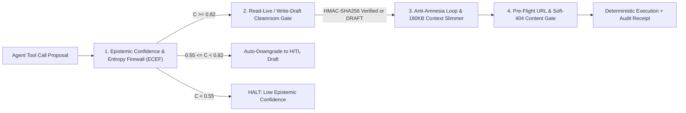

# AriaWave METACOGNITION™ (`v1.0.0`)

**Deterministic Self-Auditing Recursive Agent Harness · Epistemic Confidence & Entropy Firewall (`ECEF`) · Read-Live / Write-Draft MCP Cleanroom Gate (`HMAC-SHA256`) · Anti-Amnesia Loop Detector & `180KB` Rolling Context Slimmer · Pre-Flight Soft-404 Link & Media Verifier**

[](LICENSE)
[](https://www.python.org/)
[-22c55e.svg)](#quick-start--self-test)
[](https://www.ariawave.tech/open-source)

Built and operated in production by **[Aria Technology Group LLC](https://www.ariawave.tech)** (`127 E 3rd St, Rochester, MI 48307`) across **1.55B+ cumulative agent tokens** and **743+ multi-agent sessions** (Hermes, Antigravity, Paperclip, and Twenty CRM).

---

## Why AriaWave METACOGNITION™ Exists

Standard LLM agent wrappers fail silently in production:
1. **Low-Confidence Hallucinated Mutations:** Agents guess missing CRM or billing IDs and fire live API calls instead of staging a Human-in-the-Loop (HITL) draft.
2. **Test-Fixture Contamination & Unguarded Writes:** Synthetic benchmark fixtures (`TEST-FIXTURE-*`) leak into live QuickBooks Online, HubSpot, or Twenty CRM ledgers.
3. **Infinite Tool Loops & `180KB` Prompt Budget Stalls:** Agents repeat identical search/vision calls until they exceed the `180,000`-character context window and freeze mid-turn.
4. **Soft-404 Outbound Links:** Single-Page Applications (Next.js / React) return `HTTP 200` on missing routes while rendering `<title>404: This page could not be found</title>`, fooling naive status-code checks.

**AriaWave METACOGNITION™** wraps every autonomous agent turn in **four zero-dependency mathematical and cryptographic guardrails**:



---

## The 4 Deterministic Guardrails

### 1. Epistemic Confidence & Entropy Firewall (`ECEF`)
Computes a pre-execution epistemic certainty score $C \in [0, 1]$ before any external tool call is permitted:
$$C = 0.45 \cdot S_{\text{schema}} + 0.35 \cdot P_{\text{provenance}} + 0.20 \cdot \left(1 - \frac{H(X)}{\log_2 N}\right)$$
where $S_{\text{schema}}$ is required-field completeness, $P_{\text{provenance}}$ is the fraction of fields backed by live API lookups (vs. inferred guesses), and $H(X) = -\sum p(x)\log_2 p(x)$ is the Shannon token entropy across candidate samples.
- $C \ge 0.82 \land S_{\text{schema}} = 1.0 \implies \texttt{EXECUTE\_ALLOWED}$
- $0.55 \le C < 0.82 \implies \texttt{STAGE\_DRAFT\_ONLY}$ (automatic downgrade to HITL draft)
- $C < 0.55 \implies \texttt{HALT\_LOW\_CONFIDENCE}$

### 2. Read-Live / Write-Draft MCP Cleanroom Firewall (`HMAC-SHA256`)
Enforces strict separation between read-only telemetry (`LIVE_READ`) and external financial/CRM/email mutations (`send_invoice`, `email_client`, `charge_card`, `delete_deal`, `publish_live`):
- Unconditionally blocks any payload containing `TEST-FIXTURE` or `DO-NOT-SYNC`.
- Requires either `draft_only=True` or a constant-time verified `HMAC-SHA256` human approval signature (`hmac.compare_digest`).

### 3. Anti-Amnesia Loop Detector & `180KB` Rolling Context Slimmer
- **Jaccard Tool-Loop Detection:** Computes token-set Jaccard similarity across consecutive tool invocations; halts repetitive loops when $\text{Jaccard} \ge 0.85$ across 3 consecutive turns.
- **Deterministic `180,000`-Character Context Compaction:** Preserves `messages[0]` (system prompt) and the most recent `keep_recent` turns intact while compacting older intermediate tool dumps (`240,590` chars $\to$ `46,630` chars in self-test) so long-running vision and multi-agent sessions never stall on prompt budget limits.

### 4. Pre-Flight URL & Soft-404 Verifier
Inspects both HTTP status codes and HTML `<title>` / body patterns (`404: This page could not be found`, `Page Not Found`, `Profile Not Found`) before staging any social post, client email, or deliverable link.

---

## Quick Start & Self-Test

Zero third-party packages required (100% Python 3.10+ standard library):

```bash
git clone https://github.com/AIjennings/ariawave-metacognition.git
cd ariawave-metacognition
python metacognition_auditor.py --selftest
```

### Expected Output
```json
{
  "status": "PASS",
  "engine": "AriaWave METACOGNITION™ v1.0.0",
  "checks_verified": [
    "Epistemic Confidence & Entropy Firewall (ECEF)",
    "Read-Live / Write-Draft MCP Cleanroom Gate (HMAC-SHA256)",
    "Anti-Amnesia Loop Detector & 180KB Rolling Context Slimmer",
    "Pre-Flight URL & Soft-404 Verifier"
  ],
  "sample_epistemic_verdict": {
    "confidence_score": 1.0,
    "shannon_entropy_bits": -0.0,
    "provenance_ratio": 1.0,
    "schema_completeness": 1.0,
    "decision": "EXECUTE_ALLOWED",
    "reasons": []
  },
  "budget_compression": {
    "before_chars": 240590,
    "after_chars": 46630
  }
}
```

---

## Related Open-Source Releases by Aria Technology Group
- **[`AIjennings/aria-agent-blueprints`](https://github.com/AIjennings/aria-agent-blueprints):** 23 production AI agent skills (`SKILL.md`) and deterministic CLI tools (`23/23` passing `--selftest`).
- **[`AIjennings/maverick-4k-video-director`](https://github.com/AIjennings/maverick-4k-video-director):** MAVERICK™ Autonomous 4K Commercial & Investor Film Director (`flow-cli`, 120fps optical slow-mo, spectral audio ducking).
- **[`AIjennings/ariawave-php2shell-scanner`](https://github.com/AIjennings/ariawave-php2shell-scanner):** Defensive readiness scanner for `CVE-2026-109618` & `CVE-2026-109619` (`PHP2Shell`).
- **[`AIjennings/ariawave-google-zoom-scheduler`](https://github.com/AIjennings/ariawave-google-zoom-scheduler):** Sovereign Google Calendar `freeBusy` + Zoom Server-to-Server OAuth Meeting Scheduler.

---

## License
MIT License · Copyright (c) 2026 **Aria Technology Group LLC** ([ariawave.tech](https://www.ariawave.tech)) — Andrew Jennings & Dominic Serra.
